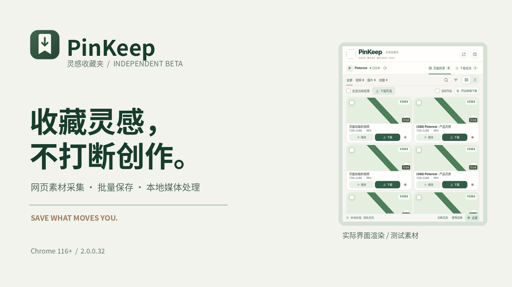
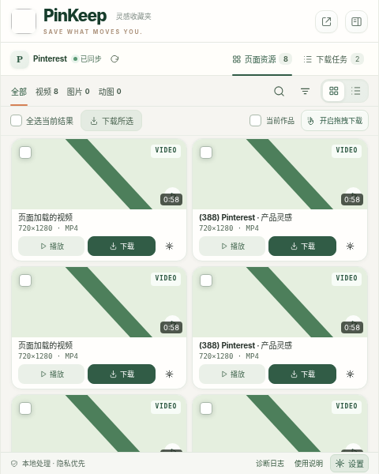
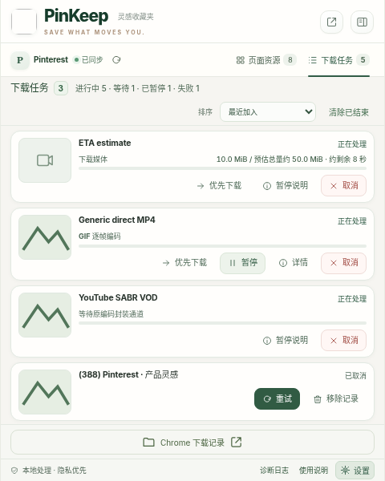
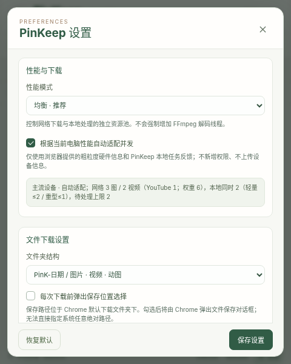

# PinKeep · 灵感收藏夹

**收藏灵感，不打断创作。**

面向视觉设计师与创作者的浏览器素材采集工具。将网页资源发现、拖拽保存、批量下载与本地媒体处理集中在一个工作台中。

## 当前阶段 · Beta 发布准备

版本：2.0.0.32（Stage IV.4）。这里是官方产品发行与用户反馈仓库，并非完整开发源码仓库。安装附件将在实机验收与适用授权义务完成后通过 [Releases](https://github.com/ingj1a/PinKeep/releases) 发布；目前尚未开放下载。

## 产品能力

- 网页图片与视频资源识别、预览、选择与批量保存。
- 网页拖拽采集，减少创作流程中的重复操作。
- 按可用资源选择清晰度与输出格式，支持本地 MP4/GIF 处理。
- 独立网络与本地资源调度、自适应性能模式、优先下载与任务排序。
- 部分路径支持暂停和恢复；本地脱敏诊断辅助排错。

以上为实际代码渲染的测试界面，素材和任务数据仅作演示。

## 下载与使用

适用 Chrome 116+。发行后请从 [Releases](https://github.com/ingj1a/PinKeep/releases) 获取明确标注的安装 ZIP，不要下载自动生成的 Source code 压缩包。[安装与更新说明](INSTALL.md) · [权限说明](PERMISSIONS.md) · [隐私说明](PRIVACY.md)

## 工程验证

[公开验证摘要](VALIDATION.md) 记录已执行的本地回归测试和未验证边界。测试不代表全部网站或设备的实机成功率。

## 反馈与支持

欢迎通过 [Issues](https://github.com/ingj1a/PinKeep/issues) 提交可复现问题和功能建议。请勿公开提交账户信息、私人 URL 或敏感日志；安全问题参考 [SECURITY.md](SECURITY.md)。爱发电支持入口由维护者确认后公布。

## 授权与使用边界

本仓库不授予 PinKeep 自研代码或品牌的开源许可。第三方组件依法保留原有许可及用户权利；完整软件发行须满足适用的分发义务。[合法使用说明](RIGHTS.md) · [授权状态](LICENSE-STATUS.md)
